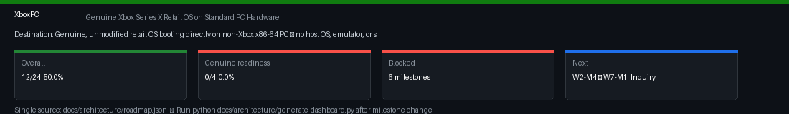
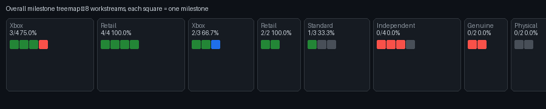
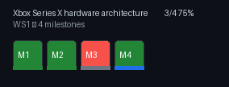
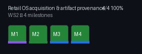
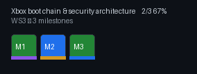
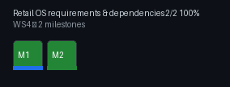
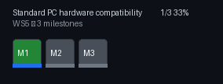
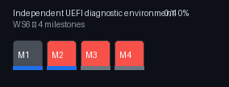
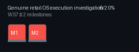
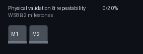

# XboxPC

> **Genuine, unmodified Xbox Series X retail OS booting directly on non-Xbox x86-64 PC hardware — no host OS, emulator, or security bypass.**

[-238636?style=for-the-badge)](#workstreams--8-parallel-tracks-to-genuine-execution)
[-da3633?style=for-the-badge)](#current-milestone-next-action-destination-readiness)

**Charter** [`PROJECT_CHARTER.md`](PROJECT_CHARTER.md) · **Audit** [`INITIAL_AUDIT.md`](INITIAL_AUDIT.md) · **Rules** [`ENGINEERING_RULES.md`](ENGINEERING_RULES.md) · **Security** [`SECURITY.md`](SECURITY.md) · **Risks** [`RISK_REGISTER.md`](RISK_REGISTER.md) · **Architecture** [`REPOSITORY_ARCHITECTURE.md`](REPOSITORY_ARCHITECTURE.md) · **Review** [`REVIEW_INDEX.md`](REVIEW_INDEX.md) · **Roadmap** [`docs/architecture/roadmap.json`](docs/architecture/roadmap.json)

**Branch** `arena/7ff9d1c6-xboxpc` @ `2359883` (PR #3 head, base `8771211` on `main`) · historical `1eac66c` `docs(xboxpc): finalize retail OS feasibility — audit-calibrated Phase 5 gate` preserved · **Previous merge** `8771211` `docs(dashboard): project continuation — reconcile phase`

---

<!-- DASHBOARD:START — generated from docs/architecture/roadmap.json do not edit manually — run python docs/architecture/generate-dashboard.py -->

### 🎯 Destination
**Genuine, unmodified Xbox Series X retail OS booting directly on non-Xbox x86-64 PC hardware, without a host OS, emulator, or security bypass.**

*Research progress ≠ execution readiness — see separate metrics below.*

**Overall:** `12/24 milestones` **50.0%** • **Genuine execution readiness:** `0/4 milestones` **0.0%** • **Blocked:** `6 milestones` • **Next:** `W2-M4 → W7-M1` *Owner sends Microsoft inquiry*

---

### Workstreams — 8 parallel tracks to genuine execution

| ID | Workstream | Done | Progress | Bar |
|---|------------|------|----------|-----|
| WS1 | Xbox Series X hardware architecture | 3/4 | 75.0% | `███████░░░` |
| WS2 | Retail OS acquisition & artifact provenance | 4/4 | 100.0% | `██████████` |
| WS3 | Xbox boot chain & security architecture | 2/3 | 66.7% | `██████░░░░` |
| WS4 | Retail OS requirements & dependencies | 2/2 | 100.0% | `██████████` |
| WS5 | Standard PC hardware compatibility | 1/3 | 33.3% | `███░░░░░░░` |
| WS6 | Independent UEFI diagnostic environment | 0/4 | 0.0% | `░░░░░░░░░░` |
| WS7 | Genuine retail OS execution investigation | 0/2 | 0.0% | `░░░░░░░░░░` |
| WS8 | Physical validation & repeatability | 0/2 | 0.0% | `░░░░░░░░░░` |

*Each square in treemap = one milestone (green completed, blue in-progress, red blocked, grey planned). Milestones only complete when evidence criteria satisfied.*

| Workstream | Treemap |
|------------|---------|
| **Xbox Series X hardware architecture** |  |
| **Retail OS acquisition & artifact provenance** |  |
| **Xbox boot chain & security architecture** |  |
| **Retail OS requirements & dependencies** |  |
| **Standard PC hardware compatibility** |  |
| **Independent UEFI diagnostic environment** |  |
| **Genuine retail OS execution investigation** |  |
| **Physical validation & repeatability** |  |

---

### Evidence discipline — five levels, honest blockers

| Class | Meaning | Example |
|-------|---------|---------|
| `VERIFIED` | Independently reproducible (Hot Chips pdf, GitHub API 348416224, fetch_page) | SoC 360.4mm²/15.3B/16GB GDDR6 |
| `DOCUMENTED` | Published Microsoft docs quoted (access-resources “recoveries of the GDK”) | GDKX Secure scope, MS rep required |
| `RESEARCHED` | ≥2 independent secondary sources (GBAtemp/futuretweets) | OSU1 $SystemUpdate layout |
| `INFERRED` | Reasonable engineering inference from verified topology | CPUID allowlist maybe, memory window fault |
| `UNKNOWN` | No public evidence — explicitly marked | Xbox CA thumbprint, ACPI dump, full Secure inventory |

- **Implementation / Build / Test / Emulation / Physical** are separate — never combine.
- `STAGED_DIFF_FOR_REVIEW.diff` is exact `git diff --cached` for substantive review.
- Review: [`REVIEW_INDEX.md`](REVIEW_INDEX.md) • Live research: [`research/xbox-os/`](research/xbox-os/)

---

### Milestones — 24 total, 12 completed, 1 in-progress, 6 blocked, 5 planned

| ID | Title | WS | Status | Evidence | Completion criteria (truncated) |
|---|-------|----|--------|----------|---------------------------------|
| `W1-M1` | SoC core architecture | Xbox | ✅ completed | `VERIFIED` | Hot Chips pdf quoted with transistor count, GDDR6 topology, GPU CU, MS... |
| `W1-M2` | SoC fabric & custom blocks | Xbox | ✅ completed | `VERIFIED` | HSP/Pluton + SHACK existence verified from Hot Chips; sequencing marke... |
| `W1-M3` | Board & firmware surface | Xbox | 🔴 blocked | `UNKNOWN` | Series X ACPI dump or Microsoft board spec published (not community in... |
| `W1-M4` | Commodity PC divergence mapping | Xbox | ✅ completed | `DOCUMENTED` | Per-subsystem delta table with Wikichip/Hot Chips citations, marked VE... |
| `W2-M1` | OSU1 official update provenance | Retail | ✅ completed | `RESEARCHED` | Support article existence verified + secondary-source unpack listing v... |
| `W2-M2` | Public GDK provenance | Retail | ✅ completed | `VERIFIED` | README missing-elements quoted + GDK vs GDKX distinction from learn.mi... |
| `W2-M3` | Secure GDKX scope | Retail | ✅ completed | `DOCUMENTED` | Public description quoted (recoveries of the GDK), illustrative includ... |
| `W2-M4` | Microsoft retail OS inquiry (unsent) | Retail | ✅ completed | `DOCUMENTED` | Packet prepared (draft + owner packet ready): all 6 Qs with Q6 neutral... |
| `W3-M1` | Boot chain mapping | Xbox | ✅ completed | `RESEARCHED` | Each stage tagged VERIFIED/INFERRED/UNKNOWN; Series X filenames marked... |
| `W3-M2` | Trust anchor & key chain | Xbox | 🔵 in_progress | `INFERRED` | Xbox CA thumbprint vs PC db comparison + fused identity provisioning f... |
| `W3-M3` | Security prohibitions & threat model | Xbox | ✅ completed | `DOCUMENTED` | Security Reviewer sign-off in EVIDENCE_AUDIT §6; audit S10 overclaim c... |
| `W4-M1` | Requirements enumeration | Retail | ✅ completed | `DOCUMENTED` | Each row lists known component, public doc, required HW, OSU1/GDK/GDKX... |
| `W4-M2` | Evidence calibration | Retail | ✅ completed | `VERIFIED` | Every claim re-graded with source/direct?/corroboration/corrected word... |
| `W5-M1` | Compatibility scenarios A–F | Standard | ✅ completed | `DOCUMENTED` | No scenario shows genuine retail OS on generic PC; D notes interface s... |
| `W5-M2` | Structured compatibility database | Standard | ⬜ planned | `UNKNOWN` | JSON schema published + at least Tier 1 reference PC profile populated... |
| `W5-M3` | CPU/GPU/firmware compatibility docs | Standard | ⬜ planned | `UNKNOWN` | Each doc lists PC vs Xbox delta, tested on QEMU vs physical, with log ... |
| `W6-M1` | UEFI probe architecture | Independent | ⬜ planned | `DOCUMENTED` | Architecture reviewed, module contracts frozen, AGENTS.md Phase 6 gate... |
| `W6-M2` | Build toolchain | Independent | 🔴 blocked | `DOCUMENTED` | dpkg -l shows gnu-efi + ovmf + qemu installed; scripts/build produces ... |
| `W6-M3` | Probe implementation & QEMU smoke | Independent | 🔴 blocked | `UNKNOWN` | EFI binary boots in QEMU+OVMF, produces hardware-report JSON matching ... |
| `W6-M4` | Physical USB validation | Independent | 🔴 blocked | `UNKNOWN` | Physical test report with environment tag physical, commit SHA, timest... |
| `W7-M1` | Authorized execution path | Genuine | 🔴 blocked | `UNKNOWN` | Microsoft written response (O1) establishing all four conditions: iden... |
| `W7-M2` | Repeatable genuine boot demonstration | Genuine | 🔴 blocked | `UNKNOWN` | Independent party reproduction on Tier 1 hardware with full evidence c... |
| `W8-M1` | Tier 1 reference PC certification | Physical | ⬜ planned | `UNKNOWN` | Per-machine profile with identifiers, firmware versions, features, tes... |
| `W8-M2` | Hardware family expansion | Physical | ⬜ planned | `UNKNOWN` | At least 2 additional Tier 2 machines with PASS/FAIL + independent rep... |

*Full criteria, dependencies, evidence refs: `docs/architecture/roadmap.json` — single source of truth.*

---

### Major blockers — displayed honestly, not hidden

- 🔴 **No legitimate retail OS artifact for generic PC in searched public sources (W7-M1 BLOCKED — inquiry UNSENT, not complete)**
- 🔴 **Toolchain missing (gnu-efi/ovmf/qemu) + no hardware provisioned (W6-M2/W6-M4) — probe is separate product**
- 🔴 **Board/firmware surface gaps (ACPI/SMBIOS dump, SMCFW, cert chain) remain UNKNOWN (W1-M3/W3-M2)**

- **Destination requires W7-M1→W7-M2 + W6-M4 + W5-M2 — all blocked.** Research 45.8% ≠ readiness 0.0%.

---

### Current milestone, next action, destination readiness

- **Current milestone:** `W2-M4` *Microsoft retail OS inquiry (unsent)* — packet `INQUIRY-READINESS-2026-11-22-001` ready with 6 questions (Q6 neutral clarification), definitions table, routes A/B1-B4 with calibrated limits, O1-O5; external action blocked until owner authorizes.
- **Next actionable:** `NA-1` Owner sends inquiry via Route A (preferred internal routing if account relationship exists) or B1 `ID@XBOX.com` (documented initial contact, ask to route if out of scope) — do NOT enroll Partner Center / accept NDA. O1 alone does NOT set feasibility; `CONDITIONALLY FEASIBLE` only when four conditions met (artifact/provenance, route+agreement, explicit PC authorization, hardware/configuration docs); O2/O3 confirms boundary.
- **Independent work:** `W6` UEFI probe is separate product `PC-hardware-report` (spec only) — not Xbox PC evidence; genuine readiness stays `0/4 NOT CURRENTLY DEMONSTRATED`.
- **Dependent work:** `W7-M1` remains `BLOCKED` (inquiry unsent, not complete) + `W7` genuine execution + `W8` physical validation blocked until Microsoft response + `W6-M4` physical logs.

| Metric | Value |
|--------|-------|
| **Overall milestone progress** | 12/24 (50.0%) |
| **Genuine Xbox OS execution readiness** | 0/4 (0.0%) — separate |
| **Destination** | Genuine unmodified retail OS on standard PC — no host OS/emulator/bypass |

---

### How to keep dashboard honest — automatic maintenance

- **Source:** `docs/architecture/roadmap.json` — milestone IDs, workstream, status, dependencies, criteria, evidence, blockers, next actionable.
- **Regenerate:** `python docs/architecture/generate-dashboard.py` — updates metrics, PNGs in `docs/architecture/assets/`, and this README section between `<!-- DASHBOARD:START -->` / `<!-- DASHBOARD:END -->`.
- **Validate:** `python scripts/verify-dashboard.py` — CI check fails if README out-of-date vs roadmap.json.
- **Rule:** `AGENTS.md` §5 + PR checklist — never edit percentages in README manually; update `roadmap.json` when evidence changes.

<!-- DASHBOARD:END -->
`.
- **Validate:** `python scripts/verify-dashboard.py` — CI check fails if README out-of-date vs roadmap.json.
- **Rule:** `AGENTS.md` §5 + PR checklist — never edit percentages in README manually; update `roadmap.json` when evidence changes.

